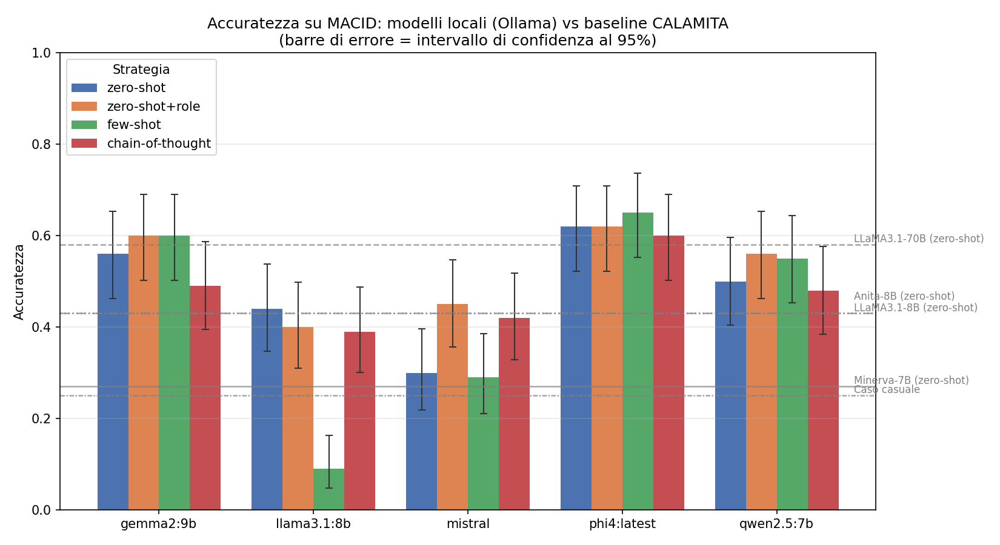

# Prompt engineering su LLM piccoli: il task MACID

Questo progetto verifica se **modelli linguistici da 7–14 miliardi di parametri, eseguiti in locale su un portatile da 16 GB di RAM**, possono eguagliare un modello da 70 miliardi grazie a tecniche di prompt engineering.

Il banco di prova è **MACID** (Multimodal ACtion IDentification), un task di comprensione dell'italiano del benchmark CALAMITA: dato un gruppo di quattro frasi che descrivono azioni fisiche (spingere, premere, sollevare…), il modello deve trovare l'intruso, cioè l'unica azione di tipo diverso. È difficile perché spesso tutte e quattro le frasi usano lo stesso verbo e la differenza è solo semantica.

## Risultati principali



| Modello | Zero-Shot | Zero-Shot+Role | Few-Shot | Chain-of-Thought |
|---|---|---|---|---|
| Phi-4 (14B) | 0.62 | 0.62 | **0.65** | 0.60 |
| Gemma 2 9B | 0.56 | **0.60** | **0.60** | 0.49 |
| Qwen 2.5 7B | 0.50 | **0.56** | 0.55 | 0.48 |
| Mistral 7B | 0.30 | **0.45** | 0.29 | 0.42 |
| LLaMA 3.1 8B | **0.44** | 0.40 | 0.09* | 0.39 |
| *Baseline: LLaMA 3.1 70B* | *0.58* | | | |

\* Crollo dovuto a un rifiuto sistematico del modello, non a errori di classificazione (vedi sotto).

- **Gemma 2 9B e Phi-4 superano la baseline da 70B** (0.58), con modelli 5–8 volte più piccoli eseguiti in locale.
- **Il Role Prompting è la tecnica più utile sui modelli deboli**: su Mistral 7B porta l'accuratezza da 0.30 a 0.45 (test di McNemar, p = 0.0026).
- **Il Chain-of-Thought non è la strategia migliore per nessun modello**, e sui modelli più forti peggiora le prestazioni.
- **La formulazione conta quanto la tecnica**: tre riformulazioni dello stesso prompt, con identico contenuto, fanno oscillare Mistral tra 0.45 e 0.26.
- **Analisi degli errori**: i modelli si affidano molto agli indizi lessicali (per Phi-4 con Few-Shot, accuratezza 0.84 quando l'intruso ha un verbo diverso e 0.51 quando lo condivide, con divari simili su tutti i modelli) e mostrano un forte **bias verso l'ultima posizione** (scelta nel 39.6% dei casi).
- **Un caso anomalo**: con il Few-Shot, LLaMA 3.1 8B rifiuta di rispondere in 74 casi su 100, citando quasi testualmente il ruolo assegnato nel prompt.

Con solo 100 quadruple, ogni accuratezza è accompagnata da un **intervallo di confidenza al 95% (Wilson)** e ogni confronto da un **test di McNemar**: le differenze tra i tre modelli migliori, per esempio, non sono statisticamente significative.

La relazione completa è in [`relazione.pdf`](relazione.pdf).

## Strategie di prompting testate

| Strategia | Cosa aggiunge |
|---|---|
| `zero-shot` | Solo la domanda, nelle stesse condizioni della baseline |
| `zero-shot+role` | Un ruolo esperto ("Agisci come un esperto linguista…") e l'output vincolato al tag `<risposta>N</risposta>` |
| `few-shot` | Ruolo, tag XML e tre esempi risolti con spiegazione |
| `chain-of-thought` | Ruolo, tag XML e la richiesta di ragionare passo dopo passo |
| `few-shot+cot` | Esempi risolti e ragionamento esplicito insieme (solo sui due modelli migliori) |
| `role-v2`, `role-v3` | Due riformulazioni di `zero-shot+role`, per misurare la sensibilità al wording |

La risposta viene estratta dal tag XML con un'espressione regolare, così la valutazione è automatica e deterministica. Tutte le chiamate usano temperatura 0, per risultati riproducibili.

## Struttura del repository

| File | Contenuto |
|---|---|
| `evaluate_macid.py` | Costruisce i prompt, interroga i modelli via Ollama e salva ogni risposta su disco man mano (se interrotto, riprende da dove si era fermato) |
| `analyze_results.py` | Grafico comparativo, intervalli di confidenza, test di McNemar, analisi degli errori (verbo condiviso, bias posizionale, matrice di confusione) |
| `relazione.pdf` | Relazione completa del progetto |
| `grafico_modelli_vs_baseline.png` | Il grafico riportato sopra |

## Come riprodurre l'esperimento

**1. Requisiti.** Python 3.10+ e [Ollama](https://ollama.com) installato e avviato.

```bash
pip install -r requirements.txt
ollama pull llama3.1:8b
ollama pull mistral
ollama pull qwen2.5:7b
ollama pull gemma2:9b
ollama pull phi4
```

**2. Dati.** Il dataset MACID è distribuito dagli autori su Hugging Face (vedi il paper citato sotto) e non è incluso in questo repository. Salvalo come `macid_data.csv` nella cartella del progetto, con le colonne `id`, `s1`, `s2`, `s3`, `s4` (le quattro frasi) e `intruder` (la posizione dell'intruso, da 1 a 4).

**3. Esecuzione.**

```bash
# Tutti i modelli con le 4 strategie base
python evaluate_macid.py

# Un solo modello
python evaluate_macid.py --modelli llama3.1:8b

# Una strategia di follow-up su alcuni modelli
python evaluate_macid.py --strategie few-shot+cot --modelli phi4:latest gemma2:9b

# Analisi dei risultati e grafico
python analyze_results.py
```

## Tecnologie

Python · pandas · NumPy · SciPy · Matplotlib · Ollama · LLM open-weight (LLaMA, Mistral, Qwen, Gemma, Phi)

## Riferimenti

- A. A. Ravelli, R. Varvara, L. Gregori. *MACID – Multimodal ACtion IDentification: A CALAMITA Challenge.* CLiC-it 2024. [ACL Anthology](https://aclanthology.org/2024.clicit-1.137/)
- *Challenging the Abilities of Large Language Models in Italian: a Community Initiative.* [arXiv:2512.04759](https://arxiv.org/abs/2512.04759) (fonte delle baseline)

## Autrice

**Miriam Magazzini** — Laureanda in Data Science, Calcolo Scientifico e Intelligenza Artificiale, Università degli Studi di Firenze.
Progetto svolto per il corso di [nome del corso], luglio 2026.
